# Giggle Studio

[](LICENSE)
[](CHANGELOG.md)
[](pyproject.toml)
[-green.svg)](docs/PLAN.md)

> **Giggle Studio** is a self-hosted, local-first, privacy-focused open-weight LLM studio, fine-tuning environment, and AI-assisted defensive reverse engineering workbench. It unifies high-performance GGUF and Transformers inference, LoRA/QLoRA training, sandboxed code execution, autonomous agent tooling, and binary analysis in a single polished application.

---

## Key Features & Status

| Category | Capability | Status |
| :--- | :--- | :---: |
| **Inference Engine** | Dedicated supervised worker process with deterministic memory cleanup | Implemented |
| | GGUF model execution via `llama.cpp` (CUDA sm_120 & CPU fallback) | Implemented |
| | OpenAI-compatible `/v1/chat/completions` endpoint | Implemented |
| | Safetensors via Hugging Face Transformers & `bitsandbytes` | Planned |
| **Placement & Offload** | Interactive layer-by-layer offload planner with VRAM/RAM allocation predictor | Implemented |
| | KV-cache quantization (f16, q8_0, q4_0) | Implemented |
| | Auto-tuning benchmark ladder (`giggle bench`) | Implemented |
| | MoE CPU expert offload | Planned |
| **Agent & Code Mode** | Sandboxed execution via Linux Bubblewrap (`bwrap`) | Implemented |
| | Multi-file Monaco code editor with workspace file tree | Implemented |
| | Step-by-step human approval policies (`safe`, `write`, `exec`, `network`) | Implemented |
| | Strict prompt-injection defense with demarcated blocks | Implemented |
| | Model Context Protocol (MCP) JSON-RPC stdio client | Implemented |
| **Training Studio** | Analytical memory preflight dry-run estimator | Implemented |
| | Multi-format dataset processor (Alpaca, ShareGPT, OpenAI) | Implemented |
| | Isolated SFT training subprocess with live SSE loss/VRAM curves | Implemented |
| | LoRA adapter merge and Hugging Face model card generation | Implemented |
| | Standalone GGUF quantization export after merge | Planned |
| | Optional Unsloth accelerator integration | Planned |
| **Defensive RE Suite** | Quarantined `0400` sample storage by SHA-256 | Implemented |
| | Static inspection for ELF and PE binaries with section entropy | Implemented |
| | Capstone x86/x64 disassembly | Implemented |
| | Bottom-up call-graph analysis and topological summarization | Implemented |
| | AI function summaries with opcode hash caching | Implemented |
| | Automated defensive YARA rule generator | Implemented |
| | Sandboxed transient dynamic analysis (`bwrap`) | Implemented |
| | Mach-O binary parsing & Sigma rule drafting | Planned |
| | Vector semantic code search across binaries | Planned |
| **Gmail Integration** | Desktop OAuth 2.0 PKCE loopback authentication | Implemented |
| | Encrypted token storage (Fernet + OS keyring) | Implemented |
| | Granular audit logging (`gmail_audit`) and message caching | Implemented |
| | Human-verified draft composition and sending | Implemented |

---

## Hardware Requirements & Platform Baseline

Giggle Studio is engineered specifically to operate reliably on constrained modern hardware:

| Component | Developed on | Minimum Supported |
| :--- | :--- | :--- |
| **Operating System** | Pop!_OS 24.04 (Linux x86_64) | Linux (kernel >= 5.15) with bubblewrap |
| **GPU** | NVIDIA GeForce RTX 5070 (12 GB VRAM, sm_120) | NVIDIA GPU (8 GB+ VRAM) or CPU fallback |
| **CPU** | Intel Core i5-10400F (6C / 12T, AVX2) | 4-core x86_64 CPU with AVX2 |
| **System RAM** | 16 GB DDR4 | 16 GB recommended (never holds duplicate weights) |
| **Storage** | NVMe SSD (fast) + HDD (data store) | 20 GB free disk space for models |

*Note on other platforms:* macOS and Windows WSL2 are currently untested and unsupported in this alpha release.

---

## Quick Start (Linux)

```bash
# 1. Clone the repository
git clone https://github.com/gigglemorgan/giggle-studio.git
cd giggle-studio

# 2. Run the automated setup script
./scripts/setup.sh

# 3. Check system diagnostics
python3 scripts/doctor.py

# 4. Start Giggle Studio
./scripts/run.sh
```
Open your web browser at `http://127.0.0.1:8420`.

---

## Architecture

Giggle Studio isolates memory-heavy machine learning runtimes from the core web service:

```
+-----------------------------------------------------------+
|               Web Browser (React + Vite UI)               |
+-----------------------------+-----------------------------+
                              | REST / SSE / WebSocket
                              v
+-----------------------------------------------------------+
|               FastAPI Server (127.0.0.1:8420)             |
|   - SQLite (WAL) + SQLAlchemy 2.0                         |
|   - Job Manager & Streaming Handlers                      |
+-------+--------------------+---------------------+--------+
        | IPC                | Subprocess          | Subprocess
        v                    v                     v
+---------------+    +----------------+    +----------------+
| Inference     |    | Training       |    | Bubblewrap     |
| Worker        |    | Subprocess     |    | Sandbox        |
| (llama.cpp)   |    | (SFT / QLoRA)  |    | (Agent & RE)   |
+---------------+    +----------------+    +----------------+
```

---

## Visual Interface & Design Tour

Giggle Studio features a bespoke, Linear/Raycast-grade dark graphite UI with electric lime accents, fully self-hosted typography (Inter & JetBrains Mono), responsive panel layouts, and complete dark/light theme support.

| View (Dark Theme) | View (Light Theme) |
| :--- | :--- |
| **Chat & Reasoning Stream**<br>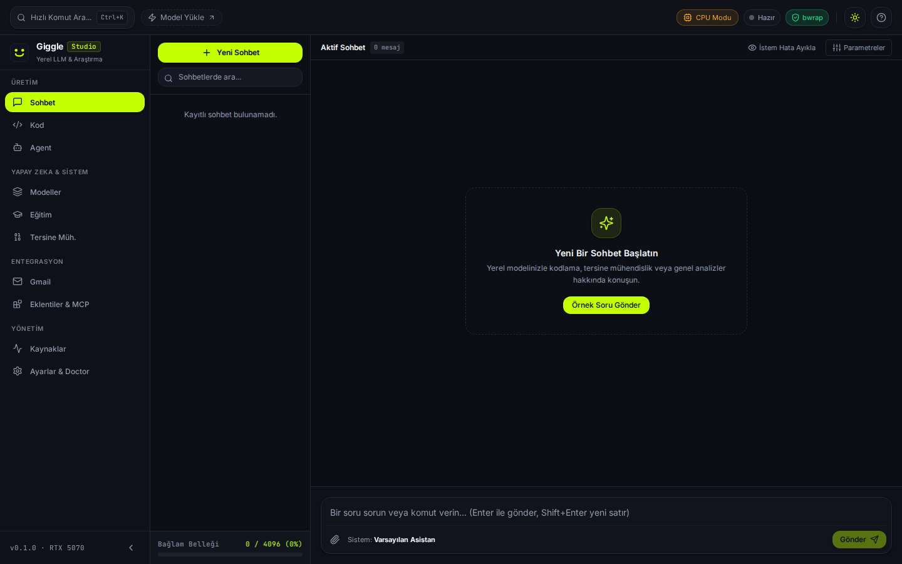 | **Chat (Light)**<br>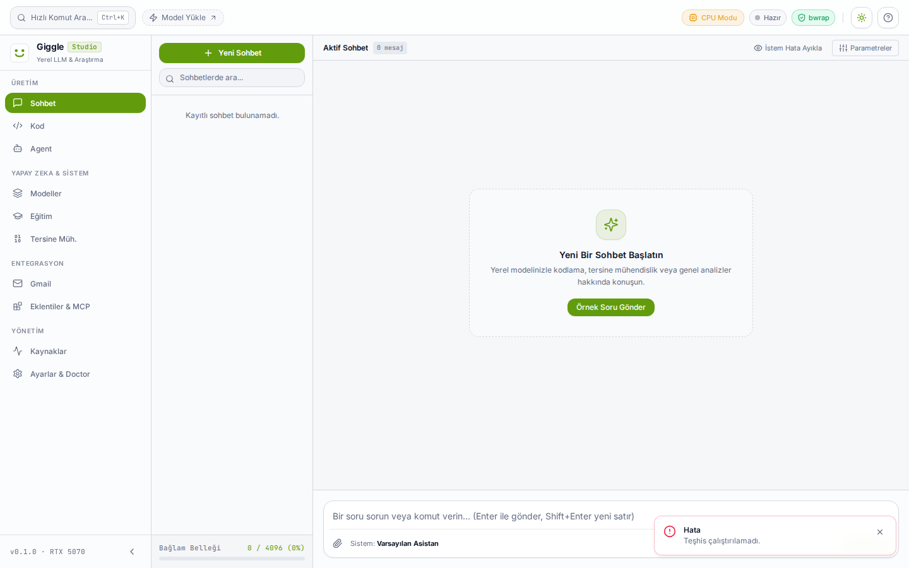 |
| **Model Manager & Offload Planner**<br>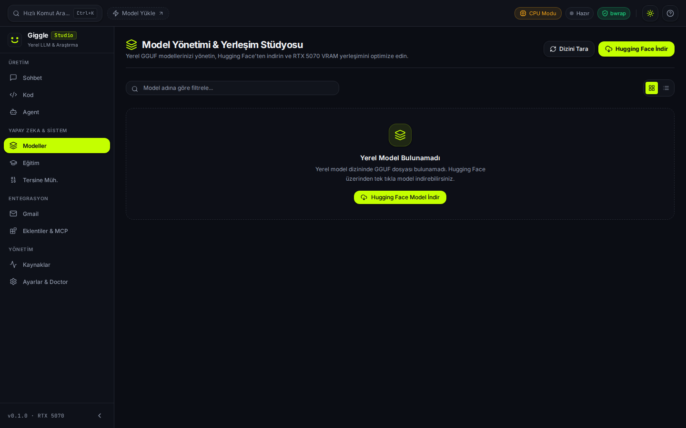 | **Model Manager (Light)**<br>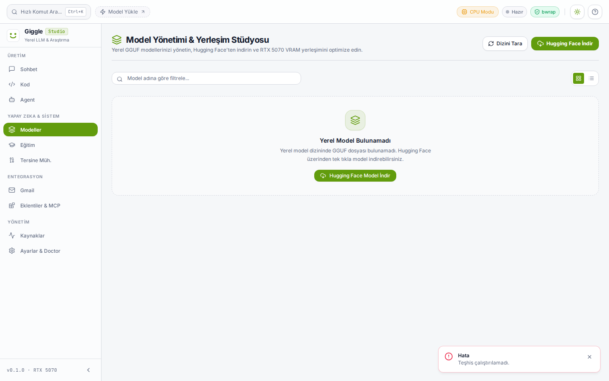 |
| **Code Studio & Monaco IDE**<br>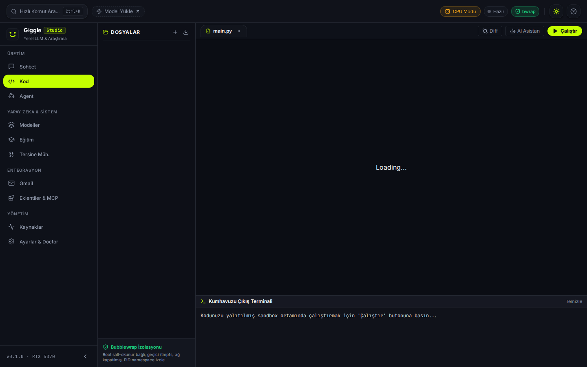 | **Code Studio (Light)**<br>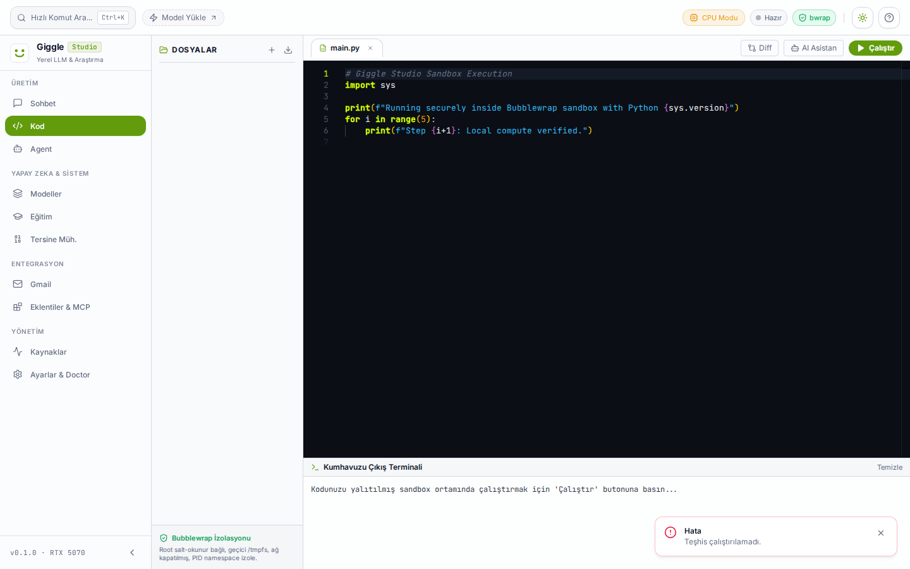 |
| **Autonomous Agent & Approvals**<br>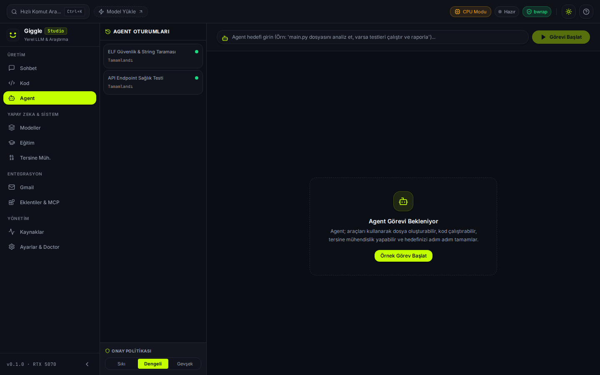 | **Autonomous Agent (Light)**<br>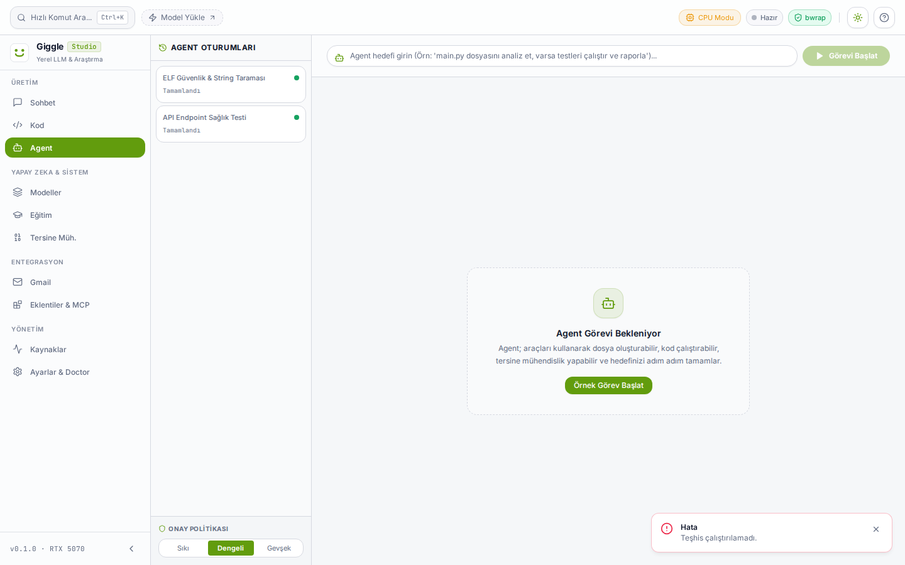 |
| **Training Studio & Preflight**<br>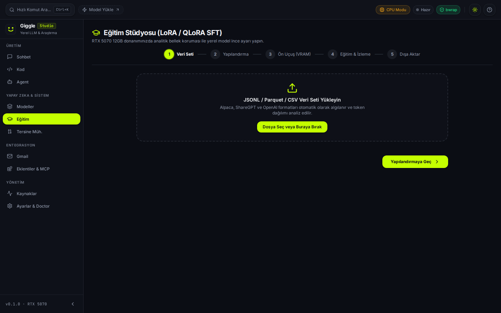 | **Training Studio (Light)**<br>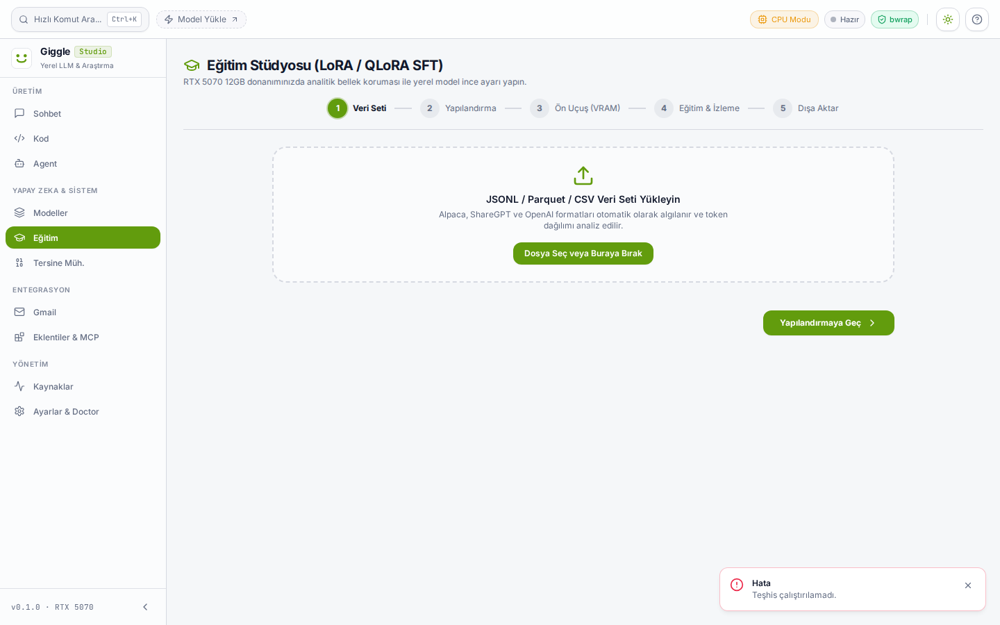 |
| **Reverse Engineering Workbench**<br>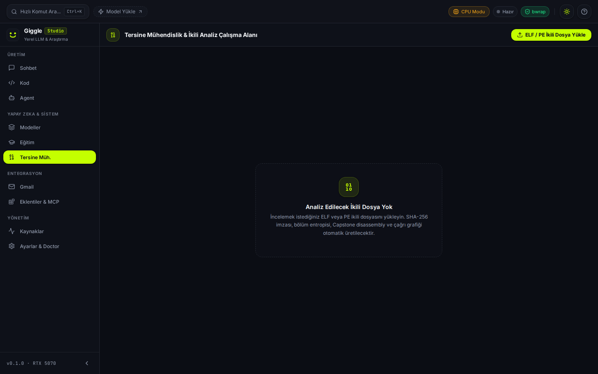 | **Reverse Engineering (Light)**<br>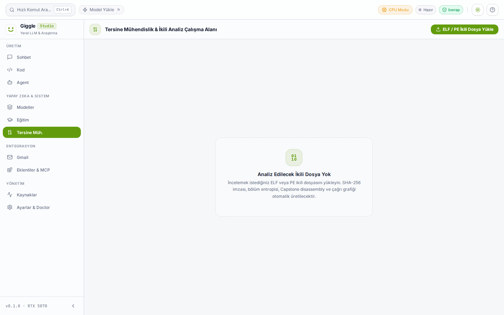 |
| **Hardware & VRAM Telemetry**<br>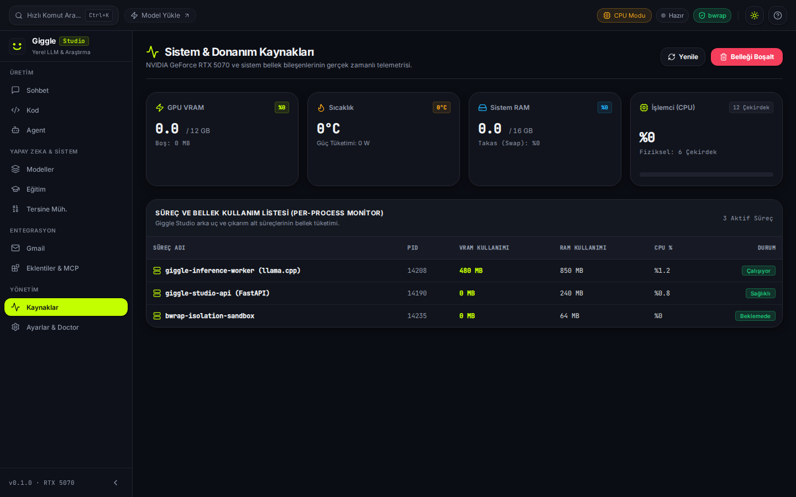 | **Hardware Telemetry (Light)**<br>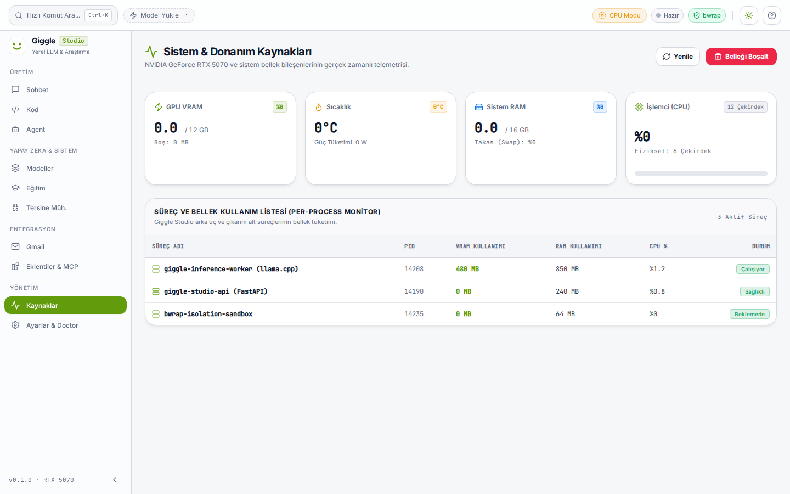 |

---

## Limitations & Alpha Notice

- This is a pre-alpha preview (`v0.1.0`). APIs and database schemas may evolve.
- Only legitimate, authorized defensive binary analysis is supported. Please review [RESPONSIBLE_USE.md](RESPONSIBLE_USE.md).
- To preserve system stability, memory allocations exceeding 85% of physical RAM or projected VRAM exceeding 11.4 GB are blocked by default.

---

## License

Giggle Studio is licensed under the [Apache-2.0 License](LICENSE).
Copyright © 2026 Sedat-gigglemorgan.
