# Giggle Studio (Türkçe)

[](LICENSE)
[](CHANGELOG.md)
[](pyproject.toml)
[-green.svg)](docs/PLAN.md)

> **Giggle Studio**, açık ağırlıklı büyük dil modellerini (LLM) yerel bilgisayarınızda çalıştırmanızı, modellerle sohbet etmenizi, kod yazmanızı, otonom agent süreçleri yürütmenizi, LoRA/QLoRA ile ince ayar (fine-tuning) yapmanızı ve yapay zeka destekli savunma amaçlı tersine mühendislik analizleri gerçekleştirmenizi sağlayan yerel öncelikli, açık kaynaklı bir stüdyodur.

---

## Özellikler ve Geliştirme Durumu

| Kategori | Yetenek | Durum |
| :--- | :--- | :---: |
| **Çıkarım Motoru (Inference)** | OS düzeyinde bellek iadesi sağlayan süpervizörlü bağımsız işçi süreci | Implemented |
| | `llama.cpp` ile GGUF model çalıştırma (CUDA sm_120 ve CPU yedekleme) | Implemented |
| | OpenAI uyumlu `/v1/chat/completions` uç noktası | Implemented |
| | Hugging Face Transformers ve `bitsandbytes` ile Safetensors çalıştırma | Planned |
| **Yerleşim & Offload** | Katman katman VRAM/RAM tahminleyicisi ve interaktif yerleşim paneli | Implemented |
| | KV-bellek kuantizasyonu (f16, q8_0, q4_0) | Implemented |
| | Otomatik kıyaslama merdiveni (`giggle bench`) | Implemented |
| | MoE uzman katmanlarının CPU'ya aktarımı | Planned |
| **Kod & Ajan Modu** | Linux Bubblewrap (`bwrap`) ile yalıtılmış kumhavuzu (sandbox) | Implemented |
| | Çok dosyalı Monaco editörü ve çalışma alanı ağacı | Implemented |
| | Adım adım insan onayı politikaları (`safe`, `write`, `exec`, `network`) | Implemented |
| | Ayrıştırılmış veri blokları ile prompt injection savunması | Implemented |
| | Model Context Protocol (MCP) JSON-RPC stdio istemcisi | Implemented |
| **Eğitim Stüdyosu (Training)** | Analitik bellek preflight deneme sürüşü hesaplayıcısı | Implemented |
| | Çoklu veri kümesi ayrıştırıcı (Alpaca, ShareGPT, OpenAI formatları) | Implemented |
| | Canlı SSE kayıp/VRAM grafikleri ile yalıtılmış SFT eğitim alt süreci | Implemented |
| | LoRA adaptör birleştirme ve Hugging Face model kartı üretimi | Implemented |
| | Birleştirme sonrası bağımsız GGUF kuantizasyon ihracı | Planned |
| | İsteğe bağlı Unsloth hızlandırma eklentisi | Planned |
| **Savunmacı Tersine Mühendislik** | SHA-256 tabanlı `0400` salt-okunur karantina havuzu | Implemented |
| | ELF ve PE ikili dosyaları için statik analiz ve kesit entropisi | Implemented |
| | Capstone ile x86/x64 ayrıştırıcı (disassembly) | Implemented |
| | Çağrı çizgesi (call-graph) analizi ve tabandan yukarı özetleme | Implemented |
| | İşlem kodu (opcode) hash önbellekli yapay zeka fonksiyon özetleri | Implemented |
| | Otomatik savunmacı YARA kuralı üretici | Implemented |
| | Geçici kumhavuzu dinamik analizi (`bwrap`) | Implemented |
| | Mach-O ayrıştırma ve Sigma kuralı taslaklama | Planned |
| | Vektörel anlamsal kod arama | Planned |
| **Gmail Entegrasyonu** | Masaüstü OAuth 2.0 PKCE döngüsel yetkilendirmesi | Implemented |
| | OS anahtarlığında şifreli belirteç saklama (Fernet + keyring) | Implemented |
| | Ayrıntılı denetim günlüğü (`gmail_audit`) ve ileti önbelleği | Implemented |
| | İnsan onaylı taslak oluşturma ve e-posta gönderimi | Implemented |

---

## Geliştirme Yapılan Sistem ve Donanım Gereksinimleri

Giggle Studio, özellikle 12 GB VRAM ve 16 GB RAM sınırlarına sahip modern donanımlarda kararlı çalışacak şekilde geliştirilmiştir:

| Bileşen | Geliştirme Yapılan Sistem | Desteklenen Asgari |
| :--- | :--- | :--- |
| **İşletim Sistemi** | Pop!_OS 24.04 (Linux x86_64) | Linux (çekirdek >= 5.15) ve bubblewrap |
| **Ekran Kartı (GPU)** | NVIDIA GeForce RTX 5070 (12 GB VRAM, sm_120) | NVIDIA GPU (8 GB+ VRAM) veya CPU yedekleme |
| **İşlemci (CPU)** | Intel Core i5-10400F (6 Çekirdek / 12 İzlek) | AVX2 destekli 4 çekirdekli x86_64 |
| **Sistem Belleği (RAM)** | 16 GB DDR4 | 16 GB önerilir (%85 tavan koruması) |
| **Depolama** | NVMe SSD (hızlı) + HDD (veri havuzu) | Modeller için en az 20 GB boş disk alanı |

---

## Hızlı Başlangıç

```bash
# 1. Projeyi klonlayın
git clone https://github.com/gigglemorgan/giggle-studio.git
cd giggle-studio

# 2. Otomatik kurulum betiğini çalıştırın
./scripts/setup.sh

# 3. Sistem gereksinimlerini kontrol edin
python3 scripts/doctor.py

# 4. Giggle Studio'yu başlatın
./scripts/run.sh
```
Tarayıcınızda `http://127.0.0.1:8420` adresine gidin.

---

## Görsel Arayüz Galerisi

Giggle Studio; Linear ve Raycast kalitesinde koyu grafit teması, elektrik lime vurgu rengi, tamamen yerel barındırılan tipografi (Inter & JetBrains Mono), duyarlı panel yerleşimleri ve eksiksiz açık/koyu tema desteği ile tasarlanmıştır.

| Görünüm (Koyu Tema) | Görünüm (Açık Tema) |
| :--- | :--- |
| **Sohbet & Düşünce Akışı**<br>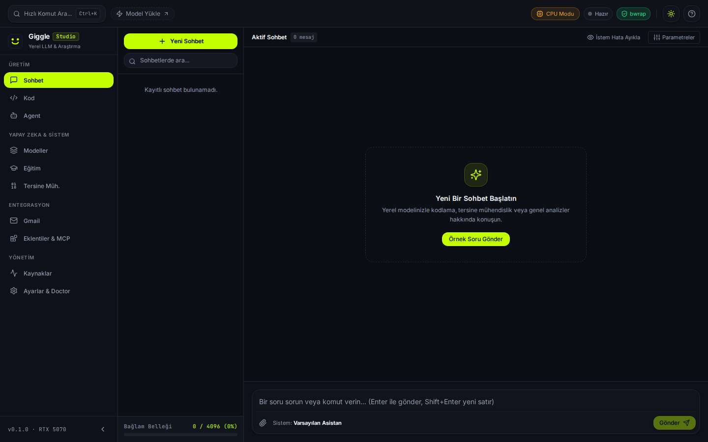 | **Sohbet (Açık)**<br>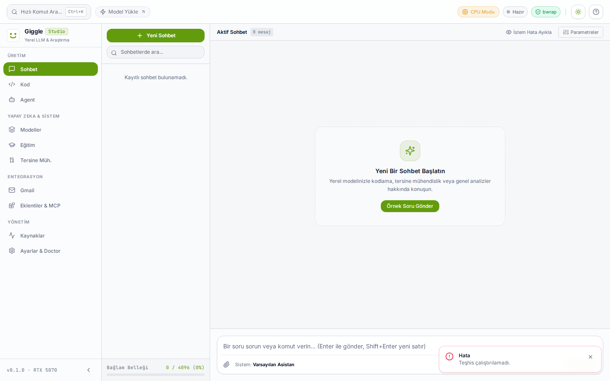 |
| **Model Yöneticisi & Yerleşim/Offload Planlayıcı**<br>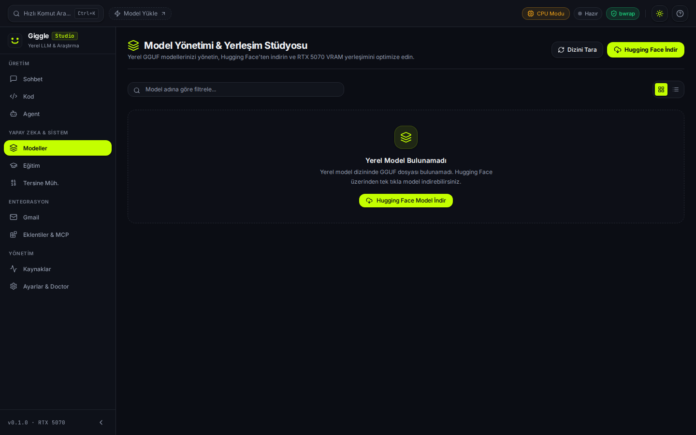 | **Model Yöneticisi (Açık)**<br>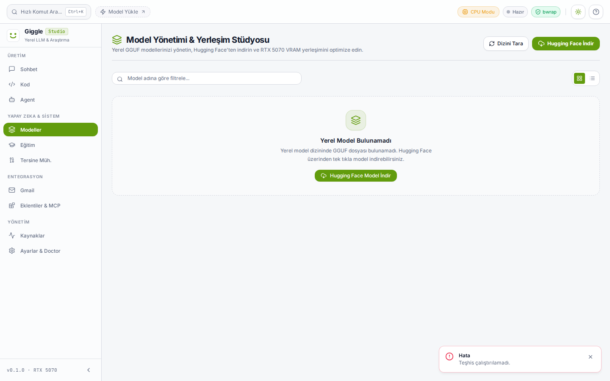 |
| **Kod Stüdyosu & Monaco IDE**<br>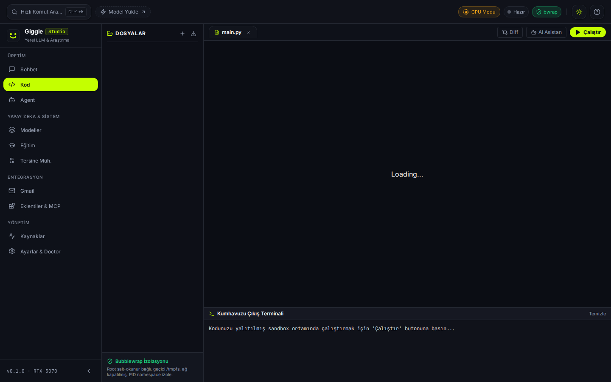 | **Kod Stüdyosu (Açık)**<br>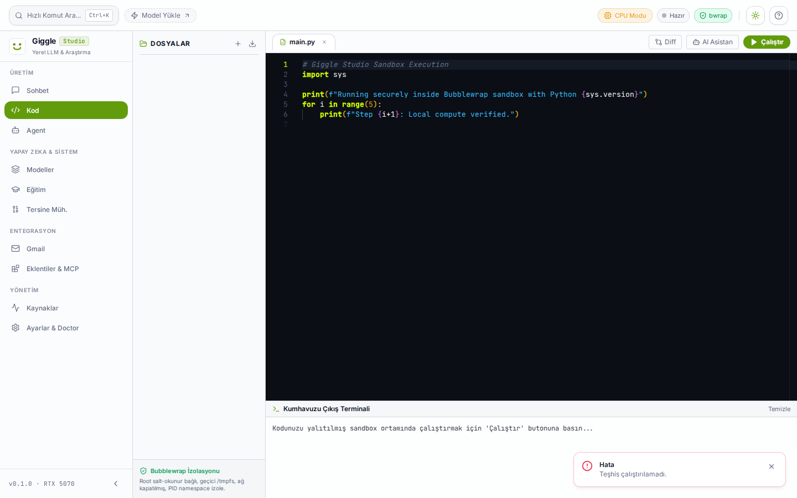 |
| **Otonom Agent & Onay Mekanizması**<br>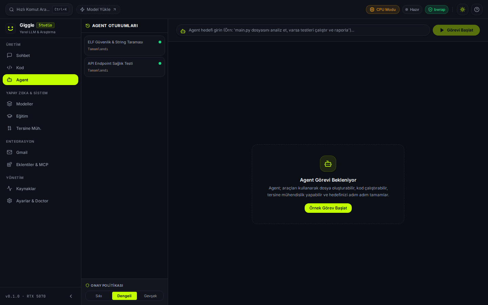 | **Otonom Agent (Açık)**<br>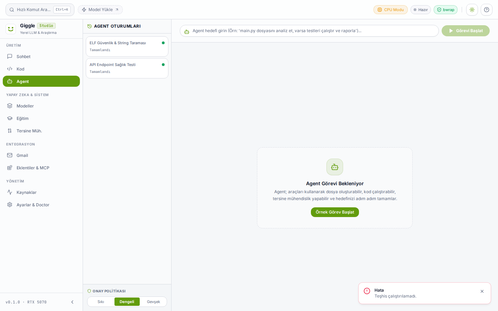 |
| **Model Eğitim Stüdyosu & Preflight**<br>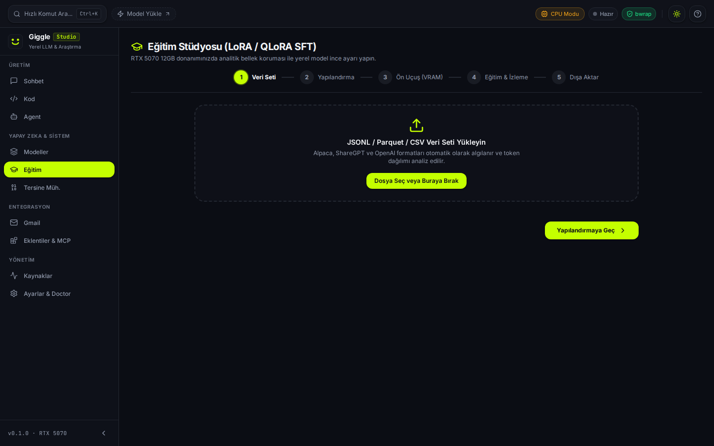 | **Model Eğitim Stüdyosu (Açık)**<br>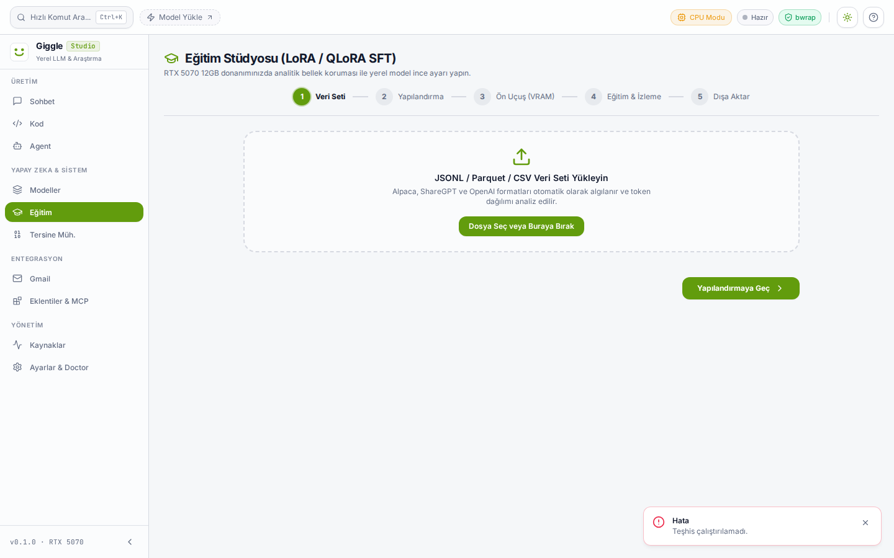 |
| **Tersine Mühendislik Tezgahı**<br>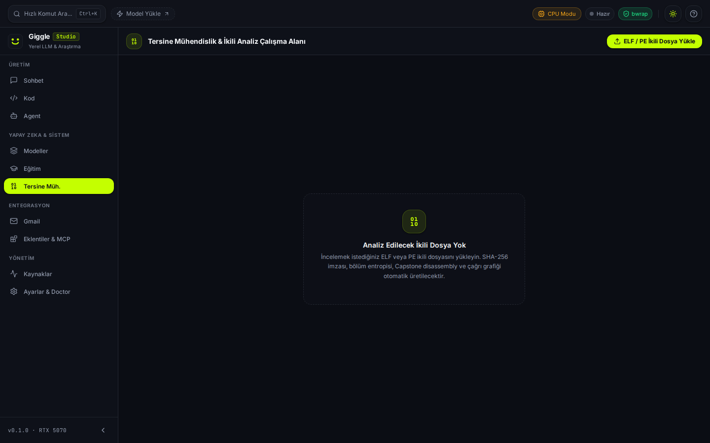 | **Tersine Mühendislik (Açık)**<br>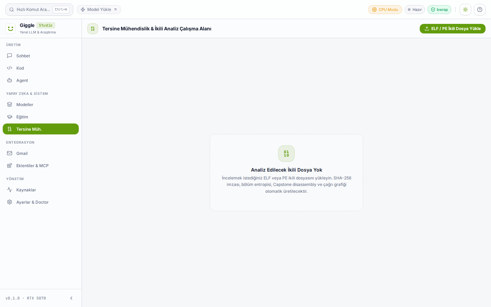 |
| **Donanım & VRAM Telemetrisi**<br>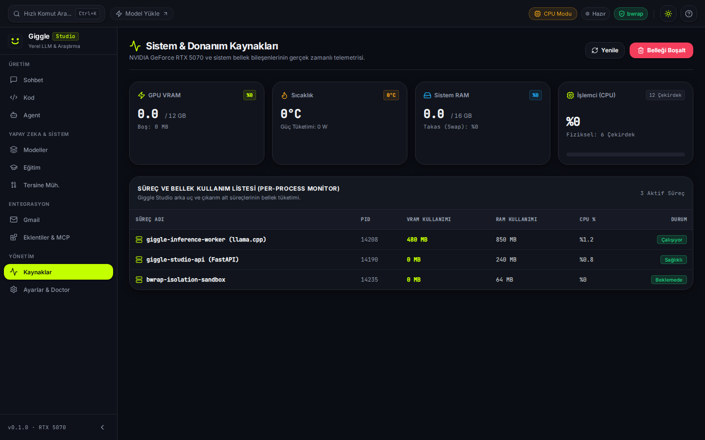 | **Donanım Telemetrisi (Açık)**<br>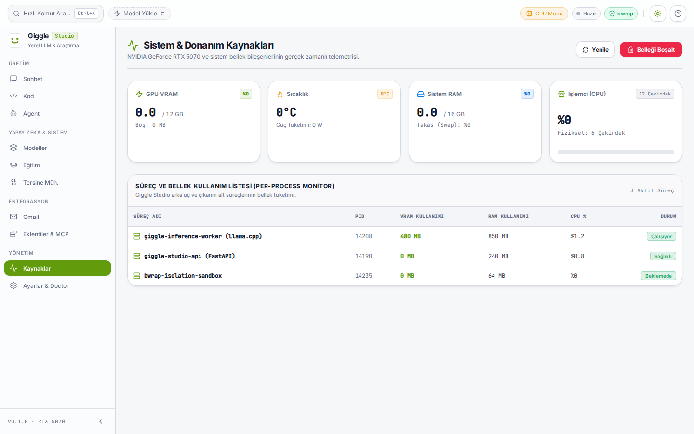 |

---

## Lisans

Giggle Studio, [Apache-2.0 Lisansı](LICENSE) altında dağıtılmaktadır.
Telif Hakkı © 2026 Sedat-gigglemorgan.
